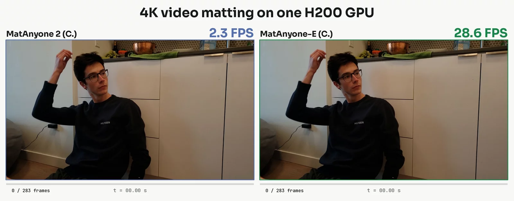
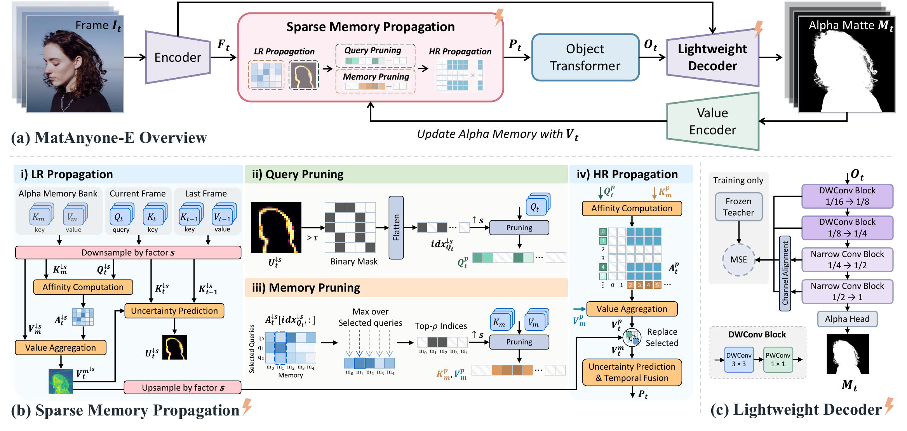

    <picture>
        <source media="(prefers-color-scheme: dark)" srcset="./assets/matanyone_e_logo_dark.png">
        
    </picture>
    <h2>Sparse Memory Propagation for Efficient High-Resolution Video Matting</h2>

    <a href='https://shuyun-wang.github.io/' target='_blank'>Shuyun Wang</a>2†&emsp;
    <a href='https://shangchenzhou.com/' target='_blank'>Shangchen Zhou</a>2†&emsp;
    <a href='https://pq-yang.github.io/' target='_blank'>Peiqing Yang</a>2&emsp;
    <a href='https://ykdai.github.io/' target='_blank'>Yuekun Dai</a>2&emsp;
    <a href='https://xinyu-au.github.io/' target='_blank'>Xin Yu</a>3*&emsp;
    <a href='https://www.mmlab-ntu.com/person/ccloy/' target='_blank'>Chen Change Loy</a>2*

    1The University of Queensland&emsp;
    2S-Lab, Nanyang Technological University&emsp;
    3University of Adelaide
     
    †Project lead&emsp;*Corresponding authors

<h4>
    
    
    
    
    
</h4>

<strong>MatAnyone-E mattes native 4K video at 28.6 FPS on a single H200 (with torch.compile), 12× faster than MatAnyone 2, using 3.1 GB of GPU memory, while keeping fine details such as hair strands.</strong>

:movie_camera: More results on the <a href="https://shuyun-wang.github.io/projects/MatAnyone-E/" target="_blank">project page</a>.

---

## 📮 Update
- [2026.10] Project page and repository online.

## 🏄🏻‍♀️ TODO
- [ ] Paper on arXiv
- [ ] Inference code and checkpoints
- [ ] Hugging Face demo
- [ ] ComfyUI custom node

## 🔎 Overview

MatAnyone-E keeps the architecture of MatAnyone 2 and replaces the two parts whose cost grows fastest with resolution:
- **Sparse Memory Propagation.** A low-resolution pass picks the uncertain query locations (*query pruning*) and the memory most relevant to them (*memory pruning*); high-resolution matching runs only on those pairs.
- **Lightweight decoder.** Designed from stage-wise latency profiling and trained by feature distillation from the original decoder.

## ⚡ Efficiency
FPS and peak GPU memory on one NVIDIA A800-SXM4-80GB (fp16); (C.) = with `torch.compile`.

| Resolution | MatAnyone 2 | **Ours** | **Ours (C.)** | MatAnyone 2 memory | **Ours** memory | **Ours (C.)** memory |
|:--|--:|--:|--:|--:|--:|--:|
| 1024×1024 | 29.5 | 41.3 | 47.3 | 1.60 GB | 0.92 GB | 0.61 GB |
| 1920×1080 | 13.6 | 26.6 | 37.6 | 5.47 GB | 1.66 GB | 1.07 GB |
| 2560×1440 | 5.6 | 16.5 | 25.1 | 16.20 GB | 3.04 GB | 2.02 GB |
| 3840×2160 | ~1.1 | 8.1 | 13.6 | ~79.69 GB | 6.08 GB | 3.89 GB |

~ extrapolated (a full memory bank does not fit in 80 GB). On one H200 with `torch.compile`: 73.07 FPS at 1080p, 28.62 FPS at 4K.

## 📑 Citation
Coming soon.

## 📝 License
This project is licensed under <a rel="license" href="./LICENSE">NTU S-Lab License 1.0</a>. Redistribution and use should follow this license.

## 👏 Acknowledgement
This project is built upon [MatAnyone 2](https://github.com/pq-yang/MatAnyone2) and [MatAnyone](https://github.com/pq-yang/MatAnyone). Thanks for their awesome works!

## 📧 Contact

If you have any questions, please feel free to reach us at `shuyun.wang@uq.edu.au`.
